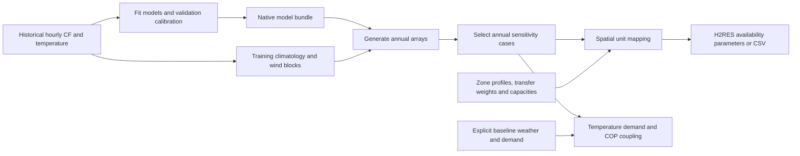

# H2RES climate pipeline

Generate annual hourly solar capacity factor, wind capacity factor and temperature profiles; select representative sensitivity cases; prepare generation-unit and temperature-dependent inputs for H2RES.

Solar and temperature use autoregressive XGBoost quantile models. Wind uses seasonal historical block resampling. Channels are generated independently. This tool prepares climate inputs; the H2RES optimizer, solver licence and complete solver database are separate.

## Start here

The current bundle is `models/training_20261019/`, using national CF calibration from 1980-2015 and residual calibration from 2016-2019. The earlier bundle remains under `models/default/`. The two bundles require different input archives. Commands and input identities are in [USAGE.md](docs/USAGE.md#training-period-calibrated-model).

| Goal | Start with | Inputs |
|---|---|---|
| Try the interface after cloning | Offline demonstration below | Installed packages only |
| Use the current Croatian model | [Training-period calibrated model](docs/USAGE.md#training-period-calibrated-model) | Exact training-calibrated corpus identified by hash |
| Replay the earlier comparison | [Recorded model](docs/USAGE.md#recorded-model) | Earlier corpus and explicit model directory |
| Use another dataset / H2RES project | [Own-data workflow](docs/USAGE.md#own-data-workflow) | Your hourly CF/temperature data and spatial mapping inputs |
| Connect output to H2RES | [Integration examples](docs/INTEGRATION.md) | Your unit names and runtime dictionaries |

## Install

Python 3.11 is the clean-environment CI target. Run commands from the repository root:

```bash
git clone https://github.com/Roko55/H2RES-climate-pipeline.git
cd H2RES-climate-pipeline
python -m venv .venv
```

Activate on Windows PowerShell with `.\.venv\Scripts\Activate.ps1`, or on Linux/macOS with `source .venv/bin/activate`. Then:

```bash
python -m pip install -r requirements.txt
python -m pip install -e . --no-deps
python -m unittest discover -s tests -v
python audit.py
```

If activation is unavailable, invoke the environment's Python executable directly. Access and reuse conditions are described in [RIGHTS.md](RIGHTS.md).

The editable installation makes `h2res_interface` importable from your own project. The CLI, models and evidence remain in this checkout. Installing the adapter does not copy or configure an H2RES optimizer.

## Offline demonstration

```bash
python examples/demo.py --output exports/demo_01
```

This uses **illustrative data, not trained-model output or research results**. It runs selection, spatial mapping, CSV export and temperature coupling without downloading data, fitting models or calling a solver.

| Output | Contents |
|---|---|
| `exports/demo_01/inputs/` | Inspectable spatial Parquet files, unit/transfer CSVs and fabricated profiles |
| `exports/demo_01/cases.npz` | Representative annual solar/wind/temperature cases |
| `exports/demo_01/units.npz` | Five unit profiles: two solar, two wind, one fixed hydro |
| `exports/demo_01/availability_2030.csv` | `year,period,<unit columns>`; periods 1–8760 |
| `exports/demo_01/demo_summary.json` | 43,800 availability entries, preserved demand totals and COP range |

Country code `ZZ` and unit names are placeholders. Reruns need a new directory, e.g. `exports/demo_02`. GitHub Actions runs this complete demo, regression tests and artifact audit.

## Processing stages



Profiles have shape `[number_of_years, 8760, 3]`, channel order `[solar, wind, temperature]` and units capacity factor, capacity factor, degrees Celsius. Leap days are removed. Irradiance and wind speed cannot be supplied in place of electrical capacity factors.

Trees alone cannot reproduce the complete pipeline: historical data also supply the wind pool and training climatology. Croatian replay requires the exact corpus; users with other data fit a new bundle with an explicit latitude. Raw source data are not redistributed. [USAGE.md](docs/USAGE.md) gives commands; [DATA.md](docs/DATA.md) defines schemas.

## Integration choices

- `orthogonal` combines separate renewable and temperature representatives; `joint_medoid` retains whole generated annual profiles. The CLI requires an explicit choice.
- `h2res_interface.py` creates `aval_factor_plant[(unit, period, year)]` or a wide CSV and rejects mismatched runtime keys.
- Temperature coupling requires explicit baseline weather and complete demand/COP dictionaries. It preserves annual heat/cooling totals and returns copies without changing caller inputs.
- `export-units --exclude-hror` supports solar/wind-only projects without hydro input files.

Cold/normal/hot and low/average/high are relative ensemble labels, not calibrated event probabilities. Spatial ratios are historical climatologies, not new spatial weather realizations. Apply the annual interface before project-specific time aggregation; see [INTEGRATION.md](docs/INTEGRATION.md).

## Validation and research evidence

[VALIDATION.md](docs/VALIDATION.md) separates tested functionality, scientific claims and external dependencies. [AUDIT.md](AUDIT.md) records the causal warmup correction and replay limits. Models, source/data hashes and execution records are under `models/` and `provenance/`.

The [recorded comparison](docs/RESEARCH_RESULTS.md) and [autoencoder experiment](https://github.com/Roko55/H2RES-autoencoder) evaluate annual wind diversity and other metrics. Results are retrospective because upstream calibration overlaps reporting years. New fits are separate from those measurements.

## Repository map

| Path | Purpose |
|---|---|
| `pipeline.py` | Validated train/generate/select/export commands |
| `h2res_interface.py` | Availability and temperature adapters |
| `examples/demo.py` | Complete offline interface demonstration |
| `scripts/` | Generation, scenario-selection and thermal methods |
| `tests/` | Synthetic regression and cross-project checks |
| `models/training_20261019/` | Current native quantile models and calibration |
| `models/default/` | Earlier native model bundle |
| `docs/` | Usage, schemas, integration, validation and recorded results |
| `provenance/`, `results/` | Source identity, replay evidence and measurements |

See [troubleshooting](docs/USAGE.md#troubleshooting) for input and environment errors.
