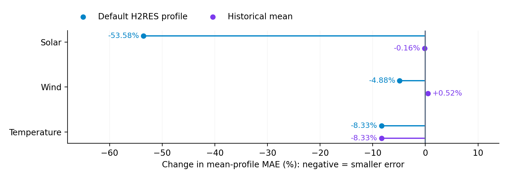

# H2RES climate pipeline

Generate hourly solar and wind capacity factors and ambient temperature, select
annual sensitivity profiles and prepare climate inputs for H2RES.

Solar uses seven autoregressive XGBoost quantile models with fixed seasonal
postprocessing. Temperature uses three autoregressive quantile models. Wind uses
six-day seasonal historical blocks with four-hour blending. Channels are generated
independently. Profiles use UTC, 8760 hours per year with February 29 removed,
and channel order **solar CF, wind CF, temperature in degrees Celsius**.

## Installation

Use Python 3.11 in a virtual environment. From this checkout:

```bash
python -m pip install -r requirements.txt
python -m pip install -e . --no-deps
python -m unittest discover -s tests -v
python audit.py
python examples/demo.py --output exports/demo_01
```

The demo uses illustrative weather and unit tables. It runs selection, spatial
mapping, availability export and thermal coupling. Use a new output name on reruns.

## Profiles and H2RES inputs

The workflow has four steps:

1. Generate annual solar, wind and temperature profiles, or load the included ensemble.
2. Select complete annual profiles for the defined sensitivity cases.
3. Map aggregate solar/wind CF to generation units using training-period regional
   profiles, transfer weights and unit capacities. Capacity-weighted aggregation
   recovers the input CF within the checked tolerance.
4. Apply temperature-dependent heat/cooling demand shapes and heat-pump COP,
   then export the availability and thermal parameter dictionaries for H2RES.

```bash
python pipeline.py replay --output exports/accepted.npy
python pipeline.py select-final --design channel --year 2030 --output exports/channel_cases_2030.npz
```

The included ensemble is `profiles/accepted.npy`, shape `[100,8760,3]`, float32.
`replay` regenerates solar from its native models and retains the stored wind
and temperature channels. Full generation additionally needs the original corpus,
including the wind resampling pool; see [Usage](docs/USAGE.md).

The `channel` design exports Average, Solar Low/High, Wind Low/High and Cold/Warm.
Each case changes one complete hourly channel from the same Average profile.
The multisector heat/cooling/COP adapter then applies the temperature chronology.
In the archived multisector runs, all seven paths start from common 2020 stock
and carry their own subsequent investments and retirements through 2050. Their
stationary-weather inputs are defined in [CHANNEL_RESULTS.md](docs/CHANNEL_RESULTS.md).

Map these profiles to your declared generation units with `export-units`, then use
`h2res_interface.py` for availability dictionaries or CSVs. See the
[data schemas](docs/DATA.md) and [integration examples](docs/INTEGRATION.md).
Frozen executed model sources and audited outputs are included under
[`evidence/calibrated`](evidence/calibrated/README.md). Re-solving the energy
experiments additionally requires the original input database and licensed optimizer.

## Results

The current result package corresponds to the checked V6.1 manuscript, sections 4.1-4.6:

| V6.1 section | Contents |
|---|---|
| 4.1 | Mean-profile MAE against both fixed and historical references; fair CRPS against the historical ensemble |
| 4.2-4.4 | Solar, wind and temperature in seven stationary-weather multisector paths; 42 new planning windows (2025–2050), after one common calibrated 2020 base |
| 4.5 | Average-path costs, new capacity, energy supply and direct domestic emissions |
| 4.6 | 45 full-year operating checks of three separate fixed 2030 electricity portfolios |

[Results and figure index](docs/RESEARCH_RESULTS.md) maps every reported result to
the manuscript. Included result figures are byte-identical to those in the V6.1
manuscript identified in `provenance/manuscript/scope.json`.

```bash
python analysis/manuscript_results.py --output exports/v61_tables
```

The command verifies experiment and figure identities, regenerates the supporting
tables and plots the six mean-profile MAE comparisons. Raw weather is needed to
recompute weather scores or redraw the historical distribution and week plots.



Both temperature markers show the same comparison: the fixed temperature
reference is the training-period hourly mean. These are two reference labels
for the same score.

The revised energy cohort has no new national electricity-generation additions.
Solar and wind cost rankings are Low > Average > High at every future window.
All 30 full/half-exchange operating checks serve HR demand; three 2021
zero-exchange cases have small HR shortfalls. All 45 checks are retained.
See [the results index](docs/RESEARCH_RESULTS.md) for accounting boundaries and units.

## Reproducibility

[Verification](docs/VALIDATION.md) covers model and result identities, profile
selection, objective reconciliation, stock, emissions and balance records.
Training uses 1980-2015 and validation 2016-2019. Reporting years 2020-2024 had
previously been inspected and are retrospective. Low/High and Cold/Warm identify
designed sensitivities. Cluster fractions describe membership in the generated ensemble.

The [autoencoder study](https://github.com/Roko55/H2RES-autoencoder/tree/v0.1.0)
retains its own model and historical comparison corpus.

For a fixed reference, cite [version 0.8.0](https://github.com/Roko55/H2RES-climate-pipeline/tree/v0.8.0).
Earlier publication snapshots remain available through their original version tags.
Raw weather and full solver inputs are excluded. Reuse rights are described in
[RIGHTS.md](RIGHTS.md).
