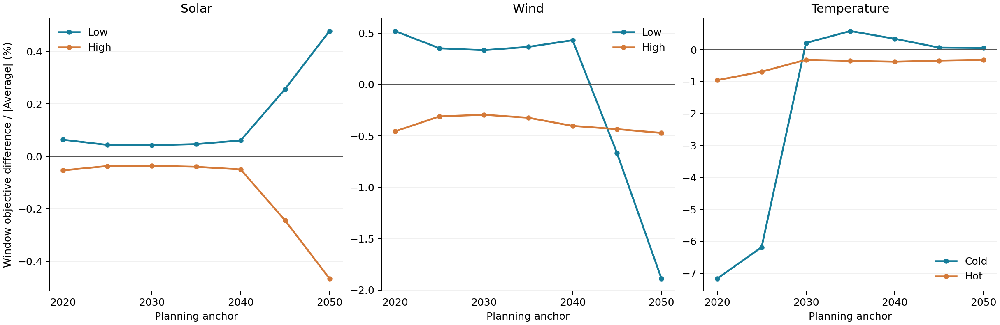
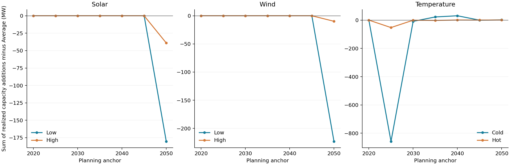
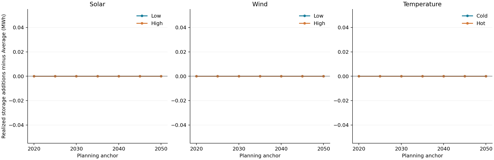

# Individual solar, wind and temperature analyses

The same full multisector H2RES model is evaluated with one climate channel
changed at a time. Seven paths cover anchors 2020, 2025, ..., 2050. Each native
window contains the current and next anchor, except the terminal 2050 window.
The completed package has 42 new optimal windows and seven reused Average windows.
Average reuse is supported by input, full-state and model reconstruction records.

## Profile selection

Donors are zero-based member indices in the included 100-member ensemble:

| Case | Solar donor | Wind donor | Temperature donor |
|---|---:|---:|---:|
| Average | 65 | 65 | 65 |
| Solar Low | 2 | 65 | 65 |
| Solar High | 28 | 65 | 65 |
| Wind Low | 65 | 20 | 65 |
| Wind High | 65 | 72 | 65 |
| Cold | 65 | 65 | 41 |
| Hot | 65 | 65 | 48 |

Solar and wind donors are the members nearest the outer-cluster means of separate
three-cluster K-means fits to annual CF (seed 42, n_init 10). Cold/Hot use the outer
thermal-index cluster representatives: standardized cooling degree hours above
22 C minus standardized heating degree hours below 18 C. Average member 65 belongs
to each central cluster and is kept as the common reference. Selection uses the
generated ensemble before the energy runs. Full Cold/Hot chronologies are retained.

## Planning-year input trends

The input trends apply linearly from 2020 to 2050: solar x1.03, wind x0.92,
temperature +1.5 C, with CF clipped to [0,1]. All 49 resulting profile hashes are
verified against `scenario_inputs.csv`. Spatial mapping checks cover both resource
channels after mapping, including channels held fixed.

At 2020, Solar Low/Average/High mean CF is 0.105242/0.110304/0.114586;
Wind Low/Average/High is 0.226350/0.244826/0.261186. Cold/Average/Hot mean temperature
is 11.3931/12.3375/12.8434 C. The complete input ranges and degree hours are retained
in the tables. Effects across channels depend on these different selected ranges.

## Model and accounting

Each path starts from the same complete 2020 stock. Later anchors inherit that
path's own realized investments and retirements. Prices, policies, technology
assumptions, hydro, exchange capacities, equations and solver tolerances retain
the accepted multisector configuration. Temperature uses the existing hourly
heat/cooling/COP adapter, with `scale_annual_totals=False`. Inspect `thermal_inputs.csv`
for the executed annual demand totals and COP statistics.

`investments_by_technology.csv` contains only decisions realized at the current
anchor (`realized=1`, `decision_year=window_start`). Decisions for the next anchor
are provisional and excluded. `installed_stock.csv` separates remaining original
stock, inherited new stock, current additions and resulting installed stock.
Retirements after the first anchor are derived from successive native stock records.

MW measures equipment capacity. MWh measures stationary-battery and hydrogen-store
energy capacity. The `capacity_addition` column is a **0/1 inclusion flag**;
`value` holds the capacity. `extra_cap_inv` is retained as a native objective
term but excluded from sums of physical additions. Native objective contributions
use each row's saved coefficient and discounting. Per-window objectives retain
their model monetary convention; summing overlapping windows would double-count.
Imports are endogenous; input-side exports retain the model's accounting convention.

## Tables

All paths below are under [`results/channel_investments`](../results/channel_investments):

| File | Contents |
|---|---|
| `scenario_inputs.csv` | Donor indices, calendar means, degree hours and profile hashes |
| `objective_comparison.csv` | Window objective, numerical violations, difference and percent relative to Average |
| `objective_components.csv` | Native components; use `active_in_objective=1` to reconcile each window |
| `investments_by_technology.csv` | Realized native decision values, units, coefficients and contributions |
| `installed_stock.csv` | Inherited and resulting stock plus derived retirements |
| `channel_comparison.csv` | Asset-level capacity and investment-contribution differences from Average |
| `system_outcomes.csv` | Native annual generation, heat, imports, CEEP and emissions by saved family/key |
| `thermal_inputs.csv` | Annual demand sums and hourly mean/min/max, or dimensionless COP statistics |
| `summary/objective_summary.csv` | Window comparison joined to the actual channel input ranges |
| `summary/investment_summary.csv` | Realized additions by family, anchor and physical unit |
| `summary/capacity_changes.csv` | Sum of addition differences, with MW and MWh kept separate |

Demand sums are MWh over the hourly year. COP mean/min/max are dimensionless;
the COP `sum` column is an arithmetic sum of hourly ratios. `key_json`
preserves the native asset/system/year indices. The stored `source` paths identify
the original result locations, made relative for portability.

## Results and figures

Solar Low has a higher objective than Average at every anchor. Wind Low is higher
through 2040, then lower in 2045/2050. Cold is lower in 2020/2025 and higher later.
The differences are conditional on the stated input ranges and each path's
subsequent stock history. Input ranges are listed in `scenario_inputs.csv`.



Objective panels use separate vertical scales. Percentage is
`100 * (case objective - Average objective) / abs(Average objective)`.



The MW plot sums realized additions across the listed equipment families.
Family-level additions are in `summary/investment_summary.csv`; resulting
installed capacities are in `installed_stock.csv`.



The MWh plot sums stationary-battery and hydrogen-store additions. PNG and vector
PDF versions are provided. Storage-addition differences are zero in these runs.
Capacity panels also use independent vertical scales. Reproduce all summaries and plots with:

```bash
python analysis/channel_results.py --output exports/channel_summary
```

The command verifies all 49 profile hashes, donor selection, Average reuse, numerical
tolerances, objective decomposition and realized investment differences. It also
checks the archived 2009 stock, 273 emission and 49 balance verification records.
No new historical operational tests were run for these seven paths. The earlier
45 operational cases retain their original electricity portfolios and weather years.
