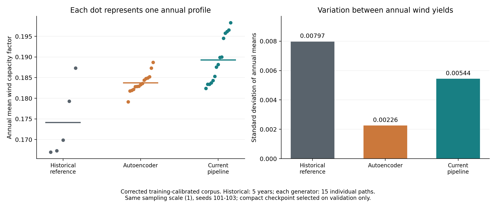

# Profile comparison

The research evaluation distinguishes the repeated central generated profile
from individual annual paths. Against the fixed H2RES baseline, reporting-period
solar and wind MAE decrease by 53.8% and 44.6%. Temperature MAE changes from
3.177 to 3.170 degrees Celsius. These are central-profile comparisons, not
event forecasts. Full metrics are in `results/profile_validation/`.

The empirical central 95% calendar-hour range covers 24.18% of solar daylight
observations and 8.24% of temperature observations in the previously inspected
2020-2024 reporting period. The 80% coverages are 16.85% and 5.38%, respectively.
Thus these generated ranges are not calibrated prediction intervals. The fixed
climatological drift produces narrow solar and temperature ensembles; improved
central-profile error should not be interpreted as complete weather variability.
Solar daylight uses one shared mask derived exclusively from training data;
including night-time zeros would otherwise inflate coverage. Interval width,
CRPS, path statistics and distribution distances accompany these measured
coverages. They describe separate channel distributions, not joint weather
event probabilities.

For annual wind resource diversity, five historical years are compared with
15 individual autoencoder paths and 15 pipeline members. The autoencoder
checkpoint is validation-selected. Both generators use the same
training-calibrated corpus and reporting reference.
Autoencoder sampling uses prior scale 1 and seeds 101-103. The pipeline
comparison selects recorded member indices from its frozen ensemble using
these seeds; it does not generate a new ensemble for each comparison row.

| Wind diagnostic | Historical | Autoencoder | Pipeline |
|---|---:|---:|---:|
| SD of annual mean CF | 0.007968 | 0.002258 | 0.005439 |
| Fraction of historical annual-mean SD | 100% | 28.3% | 68.3% |
| Mean 95th-percentile absolute hourly ramp | 0.090553 | 0.057743 | 0.085004 |

The autoencoder is better on mean wind path score (0.302637 versus 0.345773)
and Wasserstein distance (0.022452 versus 0.025282). The pipeline better
represents annual wind diversity and ramps in this sample; no uniform
superiority or better H2RES investment outcome is inferred. Plotting values
and metrics are in `results/wind_comparison/`.

Central-profile errors use five concatenated non-leap years with the first
168 hours removed (43,632 observations per channel). Distribution and range
diagnostics use all five years (43,800 observations per channel), with the
shared daylight mask applied where indicated.

National calibration uses 1980-2015, validation uses 2016-2019 and reporting
uses 2020-2024. The reporting period was previously inspected. Descriptive
sample spreads are not calibrated rare-event probabilities.
